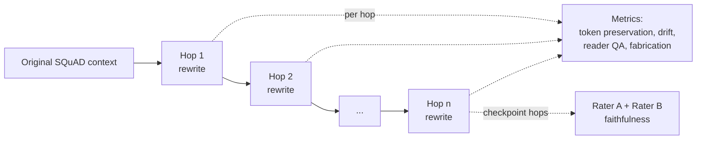

# Quantifying Semantic Drift and Hallucination Accumulation in Sequential Multi-Agent LLM Architectures

Research artefact for the MSc Computer Science dissertation (module 7COM1039) at the University of Hertfordshire.

When a passage is rewritten by one LLM agent, and that rewrite is handed to the next agent, and so on, does meaning degrade and do hallucinations accumulate? This repository contains a Streamlit experimental framework that measures exactly that: a "telephone game" of homogeneous rewriting agents, evaluated against the SQuAD v2.0 benchmark.

---

## Contents

- [Overview](#overview)
- [Experimental design](#experimental-design)
- [How it works](#how-it-works)
- [Metrics](#metrics)
- [Installation](#installation)
- [Running an experiment](#running-an-experiment)
- [Reproducing the full 3×3 matrix](#reproducing-the-full-33-matrix)
- [Bootstrap confidence intervals](#bootstrap-confidence-intervals)
- [Tests](#tests)
- [Output files](#output-files)
- [Repository structure](#repository-structure)
- [Design notes and limitations](#design-notes-and-limitations)
- [Author and context](#author-and-context)

---

## Overview

Earlier work on multi-agent LLM pipelines varies prompts, roles and temperatures across agents, which confounds the measurement of pipeline depth. This artefact removes that confound:

- **Homogeneous pipeline.** Every hop is the same agent running the same rewrite prompt in a self-looping LangGraph graph.
- **Temperature is the only agent-side variable.** Pipeline depth and generation temperature form a 3×3 factorial design.
- **Standard benchmark.** Passages and questions come from SQuAD v2.0 (dev set), scored with official-style Exact Match (EM) and token F1, including unanswerable questions to detect fabrication.
- **Baseline-controlled.** The reader is also run on the untouched original passage (n=0), so degradation can be attributed to the pipeline rather than to the reader's own limits.
- **Dual-rater faithfulness.** Two different model architectures judge faithfulness independently, which makes Cohen's κ a meaningful inter-rater reliability figure.

All inference runs locally through [Ollama](https://ollama.com), so no API keys are needed.

## Experimental design

| Factor | Levels |
| --- | --- |
| Pipeline depth (n) | 1, 5, 10 |
| Agent temperature (T) | 0.1, 0.5, 0.9 |
| Items per cell | 30 by default (15 answerable + 15 unanswerable), sampled with seed 42 |
| Dataset | SQuAD v2.0 development set (`dev-v2.0.json`) |

Each run of the app executes one cell of the matrix (one depth and one temperature). Reader and rater temperatures are fixed at 0.0, and the seed is propagated to every model call for reproducibility.

### Models

| Role | Model |
| --- | --- |
| Rewriting agent | `gemma2:2b` |
| Reader (extractive QA) | `llama3:8b` |
| Rater A (faithfulness) | `llama3:8b` |
| Rater B (faithfulness) | `mistral:7b` |
| Embeddings (drift) | `all-MiniLM-L6-v2` (sentence-transformers) |

Model names are defined in `configuration.py`.

## How it works



1. **Baseline (n=0).** The reader answers the question from the original passage. Its losses form the reader floor.
2. **Rewrite loop.** A LangGraph graph repeatedly rewrites the current text in different words until the target depth is reached.
3. **Per-hop measurement.** After every hop the reader answers the same question from the rewritten text, and drift and token-preservation scores are computed.
4. **Checkpoint faithfulness.** Raters A and B judge the rewritten passage against the original at the first hop, the midpoint and the final hop (for example hops 1, 5 and 10 at depth 10).
5. **Dashboard.** Results appear in the Streamlit app after a live run, with an agent-chain viewer showing every hop's text, drift and reader answer.

## Metrics

| Metric | Definition |
| --- | --- |
| **Core-token preservation** | Share of the original passage's content-word lemmas (nouns, verbs, adjectives, adverbs, via NLTK POS tagging and WordNet lemmatisation) still present in the rewrite. |
| **Local semantic drift** | 1 − cosine similarity between consecutive hops (MiniLM embeddings). |
| **Global semantic drift** | 1 − cosine similarity between the original passage and the current hop. |
| **Answer recoverability loss** | Reader answer versus gold answers using SQuAD normalisation. Reported as **EM loss** (strict), **F1 loss** (lenient) and **recall loss**. For unanswerable items, refusing (`CANNOT_ANSWER`) scores 0 loss and any answer scores 1. |
| **Attributable loss** | `max(0, final loss − baseline loss)`, isolating degradation caused by the pipeline from the reader's own errors. |
| **Fabrication rate** | On unanswerable items, the share of hops where the reader gives an answer instead of `CANNOT_ANSWER`. |
| **Faithfulness** | Two independent raters label the rewrite `FAITHFUL` or `HALLUCINATED` using a shared rubric but different personas. Agreement is reported with Cohen's κ. |
| **Hallucination failure** | Unanswerable item with any fabrication, or answerable item not judged faithful by both raters. |

## Installation

### Prerequisites

- Python 3.10 or later (recommended)
- [Ollama](https://ollama.com/download) installed and running
- A GPU is recommended for the 7B and 8B models. CPU inference works but is much slower.

### 1. Clone the repository

```bash
git clone https://github.com/suthansee-com/multi-agent-llm-drift.git
cd multi-agent-llm-drift
```

### 2. Create a virtual environment

**Windows**

```bash
python -m venv .venv
.venv\Scripts\activate
```

**macOS / Linux**

```bash
python3 -m venv .venv
source .venv/bin/activate
```

### 3. Install dependencies

```bash
pip install -r requirements.txt
```

The NLTK resources the app needs (`punkt`, `punkt_tab`, the averaged perceptron tagger and WordNet) are downloaded automatically on first launch. The `all-MiniLM-L6-v2` embedding model is also downloaded automatically by `sentence-transformers` on first use.

### 4. Pull the Ollama models

```bash
ollama pull gemma2:2b
ollama pull llama3:8b
ollama pull mistral:7b
```

### 5. Download the dataset

Download the SQuAD v2.0 development set, `dev-v2.0.json`, from the [SQuAD explorer](https://rajpurkar.github.io/SQuAD-explorer/). It is uploaded through the app interface and is not stored in this repository.

## Running an experiment

Make sure Ollama is running, then start the app:

```bash
streamlit run app.py
```

1. Upload `dev-v2.0.json`.
2. Set the number of **answerable** and **unanswerable** items (default 15 each).
3. Choose the **pipeline depth** (1, 5 or 10), the **temperature** (0.1, 0.5 or 0.9) and the **random seed** (default 42).
4. Click **Generate Experiment** and wait for the pipeline to finish.
5. Inspect the dashboard: reader floor and attributable loss, token preservation, drift curves, EM / F1 / recall curves, faithfulness and Cohen's κ, fabrication by hop, and the per-sample agent chain.
6. Download the results as CSV from **Export Results**. The **Run manifest** expander records the models, seed, depth and temperature used.

The dashboard is populated by a live pipeline run. Loading a previous CSV back into the dashboard is not supported.

## Reproducing the full 3×3 matrix

Run the app nine times with the same seed (42) and sample sizes, once for each combination:

| Depth | T = 0.1 | T = 0.5 | T = 0.9 |
| --- | --- | --- | --- |
| 1 | run 1 | run 2 | run 3 |
| 5 | run 4 | run 5 | run 6 |
| 10 | run 7 | run 8 | run 9 |

Download each run's CSV and keep the files together in one folder for the confidence-interval step.

## Bootstrap confidence intervals

`bootstrap-ci.py` reads exported result CSVs and prints bootstrap statistics for each depth × temperature cell:

- 95% confidence intervals from 10,000 resamples (`random_state=42`) for global drift, attributable F1 loss, final core-token preservation and fabrication rate
- The faithfulness failure rate on answerable items
- Cohen's κ between Rater A and Rater B

By default it reads `seedcheck/drift_*.csv`. To point it at your own results, edit the `glob.glob(...)` line near the top of the script (for example to `results/drift_*.csv`), then run:

```bash
python bootstrap-ci.py
```

## Tests

The suite contains 26 unit tests (`unittest`) covering SQuAD answer normalisation, EM, F1 and recall, core-token extraction and preservation, checkpoint selection, recoverability loss on unanswerable items, and the semantic drift contract.

```bash
python Test.py
```

or

```bash
python -m unittest Test -v
```

The tests exercise the scoring logic only, so they do not require Ollama to be running. They do load the embedding model and NLTK resources, so the first run may download them.

## Output files

| File | Produced by | Description |
| --- | --- | --- |
| `_drift_d{depth}_T{temp}_seed{seed}_PART.csv` | `app.py` (during a run) | Rolling partial results, rewritten after every item as a safeguard against interruptions. |
| `drift_d{depth}_T{temp}_seed{seed}_{run_id}.csv` | Download button in the app | Final per-item results for one run, plus run metadata (models, seed, dataset, timestamp). |

Per-item columns include the sample ID, question, gold answers, original and final text, per-hop histories (token preservation, local and global drift, EM / F1 / recall loss, reader answers, fabrication flags), baseline and attributable losses, both rater verdicts, rater agreement and the run manifest fields. In the CSV, `first_fabrication_hop` holds a 0/1 hallucination-failure flag rather than a hop index, and matches `is_hallucination_failure`.

## Repository structure

```
multi-agent-llm-drift/
├── app.py              # Streamlit UI: dataset upload, experiment runner, results dashboard, CSV export
├── pipeline.py         # LangGraph rewrite loop, SQuAD scoring, drift and token-preservation metrics
├── reader.py           # Extractive QA reader used at n=0 and after every hop
├── rater.py            # Dual faithfulness raters (A and B) and checkpoint selection
├── configuration.py    # Model names and the shared faithfulness rubric
├── bootstrap-ci.py     # Bootstrap confidence intervals and Cohen's κ over exported CSVs
├── Test.py             # 26 unit tests for the scoring and metric logic
├── requirements.txt    # Python dependencies
└── .gitignore
```

## Design notes and limitations

- **Rater errors.** If a rater call raises an exception, the verdict is recorded as 0 (not faithful), so infrastructure failures would be counted as hallucinations. Check the console for `Error during evaluation` messages after a run.
- **Verdict parsing.** Rater output is parsed by keyword (`FAITHFUL` present and `HALLUCINATED` absent). This is simple and deterministic, but it is not negation-aware.
- **Hard-coded results folder.** `bootstrap-ci.py` uses a fixed glob pattern instead of command-line arguments.
- **Single seed.** All reported cells use seed 42. A seed-robustness check can be run by repeating the matrix with other seeds and pointing `bootstrap-ci.py` at those CSVs.
- **Small local models.** Results reflect the specific local models listed above (a 2B rewriter and 7B/8B reader and raters). They should not be assumed to generalise to larger or hosted models.

## Author and context

Built by [suthansee-com](https://github.com/suthansee-com) as part of the MSc Computer Science dissertation at the University of Hertfordshire (module 7COM1039).

Dissertation title: *Quantifying Semantic Drift and Hallucination Accumulation in Sequential Multi-Agent LLM Architectures*.
